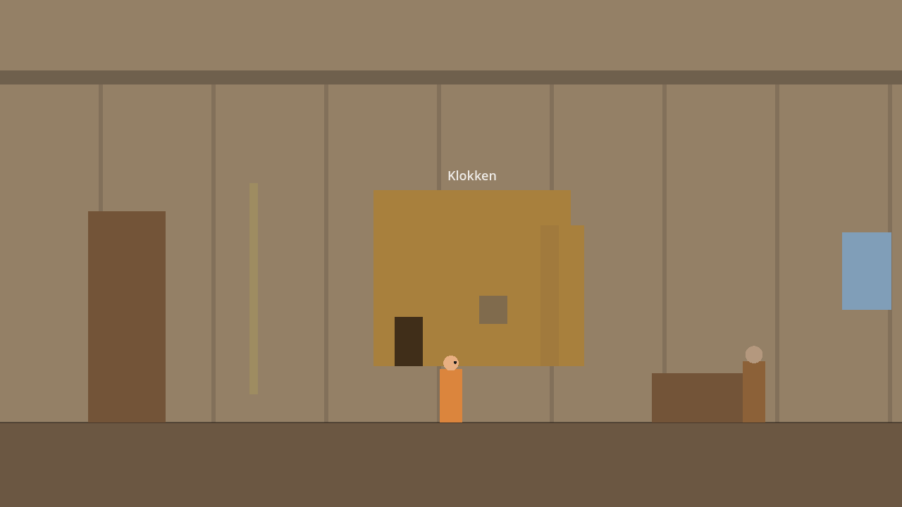

# Fagravik

Et historiedrevet 2D-eventyr i 16-bit pikselkunst, satt til Fagravik høsten 1082.

Denne mappen inneholder foreløpig **gråboks-prototypen «Den første tonen»**: én spillbar dag i Fagravik, med prologen fra flomnatten 1054. Alt er enkle rektangler og midlertidig lyd. Målet er å teste opplevelsen før kunsten lages, ikke å se pent ut.



## Slik spiller du

1. Last ned [Godot 4.4](https://godotengine.org/download) (vanlig utgave, ikke .NET).
2. Åpne Godot, velg **Importer** og pek på `prototype/project.godot`.
3. Trykk **F5** (eller ▶ øverst til høyre).

| Tast | Handling |
| --- | --- |
| ← → / A D | gå |
| ↑ / W | gå gjennom dør eller åpning |
| E | snakk / bruk |
| Q | undersøk |
| F | lytt med stemmehammeren |
| H | nynne mors vuggevise |
| I | det Ingrid bærer (velg en gjenstand for å vise den fram med E) |
| N | notatbok (Esc lukker) |
| Esc | legg fra deg gjenstanden i hånden |

En gjennomspilling tar omtrent en time første gang. Det finnes ingen hintmeny, oppdragsliste eller markører, med vilje.

**For testere (bare når spillet kjøres fra Godot):** F1 hopper til morgen, F2 til klokken, F3 til ettermiddagen og F4 til natten.

## Struktur

```
prototype/
  project.godot      Godot-prosjektet
  main.tscn          eneste scene
  scripts/
    main.gd          tegning, bevegelse, dialogmotor og overganger
    state.gd         tidsfase, flagg, inventar (autoload «State»)
    sfx.gd           lyd laget i kode: klokker, materialer, vuggevisen (autoload «Sfx»)
  data/
    rooms.gd         kartet: 13 rom, dører, gjenstander og hva Ingrid ser
    world.gd         personer, hvor de er i hver fase, gjenstander
    dialogues.gd     alle samtaler og fortellerscener
  tools/
    validate.gd      sjekker at data henger sammen
    playthrough.tscn automatisk gjennomspilling fra prolog til slutt
    paths.tscn       de andre forløpene av Toras båt
    screenshots.tscn tar skjermbildene i docs/bilder
docs/
  prototypeplan.md   hva som er bygget, og hvordan det svarer på designdokumentet
```

Alt innhold ligger i `data/`. Tekst, rom og hvem som står hvor kan endres der uten å røre koden. Formatet er forklart øverst i hver fil.

## Sjekker

```sh
godot --headless --path prototype --script res://tools/validate.gd
godot --headless --path prototype res://tools/playthrough.tscn
godot --headless --path prototype res://tools/paths.tscn
```

Den første sjekker at alle dialoger, dører, lyder og hendelser peker på noe som finnes. Den andre spiller hele prototypen fra prologen til sluttskjermen gjennom den rikeste løsningen av Toras båt (D). Den tredje tester de andre forløpene (A, B og C) fra ettermiddagen til natten.
